# Bangladesh Electricity Consumption Analysis and Demand Prediction

A Python-based data analysis and machine learning project investigating Bangladesh's electricity consumption patterns from **2019 to 2024**, using historical electricity system records from the Bangladesh Power Development Board (BPDB).

The project combines **exploratory data analysis (EDA), data preprocessing, feature engineering, and supervised regression models** to examine electricity demand trends, regional consumption patterns, seasonal variations, generation constraints, and evening-peak demand estimation.

Three machine learning algorithms—**Linear Regression, Random Forest, and Gradient Boosting**—are implemented and evaluated using historical electricity data.

---

## 1. Project Overview

Bangladesh's electricity sector has experienced significant changes in electricity demand, generation capacity, fuel availability, and load shedding over recent years.

Understanding these patterns is important for evaluating power system performance, identifying operational constraints, and supporting electricity demand planning.

This project analyzes historical daily electricity system records covering **21 November 2019 to 30 December 2024**.

The analysis focuses on:

- Long-term electricity demand growth
- Monthly and seasonal consumption patterns
- Relationships between temperature and electricity demand
- Regional electricity demand and load shedding
- Electricity generation and demand differences
- Fuel supply limitations and operational constraints
- Machine learning-based evening-peak demand estimation

The project also compares three regression algorithms to evaluate their ability to estimate electricity demand from historical operational, environmental, and temporal features.

The analysis is implemented in **Python using Google Colab and Jupyter Notebook**, with visualization and machine learning libraries.

## 2. Project Objectives

The main objectives of this project are:

1. Analyze historical electricity consumption and generation records in Bangladesh.
2. Identify long-term, seasonal, and regional electricity demand patterns.
3. Examine the relationships between temperature, generation capacity, fuel constraints, and electricity demand.
4. Investigate load shedding and electricity generation-demand differences.
5. Prepare and preprocess raw electricity system data for machine learning.
6. Develop regression models for estimating evening-peak electricity demand.
7. Compare Linear Regression, Random Forest, and Gradient Boosting using standard evaluation metrics.
8. Interpret model performance, feature importance, and prediction errors.

## 3. Dataset Description

The project uses **Version 1 of the Bangladesh Daily Electricity Dataset**, compiled from publicly available daily generation reports of the Bangladesh Power Development Board (BPDB).

### 3.1 Dataset Information

| Attribute | Description |
|---|---|
| Data source | Bangladesh Power Development Board (BPDB) |
| Dataset repository | Mendeley Data |
| Dataset version | Version 1 — Raw Extract |
| Time coverage | 21 November 2019 – 30 December 2024 |
| Original records | 1,848 daily observations |
| Original attributes | 41 columns |
| Cleaned observations | 1,844 |
| Geographic coverage | National level and nine administrative divisions |
| Prediction target | Evening-peak electricity demand (MW) |

### 3.2 Dataset Features

The dataset includes several categories of electricity system information.

**Electricity demand and generation**
- Maximum electricity demand
- Maximum and minimum electricity generation
- Day-peak and evening-peak generation
- Morning generation forecast

**Environmental and operational variables**
- Maximum daily temperature in Dhaka
- Gas and liquid fuel limitations
- Coal supply limitations
- Low water level at Kaptai Lake
- Number of offline power plants

**Regional electricity statistics**
- Divisional electricity demand
- Electricity supply
- Load shedding

The regional data cover Dhaka, Chattogram, Rajshahi, Khulna, Rangpur, Mymensingh, Sylhet, Barishal, and Cumilla.

### 3.3 Dataset Source and Attribution

The original dataset was developed by extracting and organizing daily electricity generation reports published by BPDB.

**Original BPDB archive:**

https://misc.bpdb.gov.bd/daily-generation-archive

**Dataset repository:**

https://doi.org/10.17632/x7r7wdb39k.1

This project uses Version 1, which preserves the raw extracted records, including missing values and formatting inconsistencies.

The project applies its own preprocessing, exploratory analysis, feature engineering, and machine learning methods to these records.

**Note:** The original dataset is not redistributed in this repository. Users should download Version 1 from the dataset provider to reproduce the analysis.

## 4. Data Preprocessing

The raw dataset contains missing entries, inconsistent values, and formatting issues that require preprocessing before analysis and model development.

### 4.1 Date Parsing and Chronological Organization

The date column is converted into a proper datetime format.

The records are subsequently organized chronologically to support time-series visualization and temporal feature extraction.

### 4.2 Missing and Invalid Values

Invalid zero values in the target demand column are treated as missing observations.

Missing numerical values are handled using:

- Forward-fill imputation
- Backward-fill imputation for remaining initial gaps

These methods allow the analysis to proceed with a consistent numerical dataset.

### 4.3 Outlier Removal

The Interquartile Range (IQR) method is applied to identify and remove outliers in the electricity demand column.

The lower and upper boundaries are defined as:

\[
\text{Lower Bound}=Q_1-1.5(IQR)
\]

\[
\text{Upper Bound}=Q_3+1.5(IQR)
\]

where:

\[
IQR=Q_3-Q_1
\]

After preprocessing, the dataset contains **1,844 observations**.

### 4.4 Temporal Feature Engineering

Additional time-related features are derived from the date column:

| Feature | Description |
|---|---|
| Year | Calendar year |
| Month | Month number (1–12) |
| Day of Week | Weekday index (0–6) |
| IsWeekend | Binary indicator for Friday and Saturday |

These features help represent calendar-related electricity consumption patterns.

### 4.5 Feature Scaling

StandardScaler is used for the Linear Regression pipeline to standardize numerical features.

Random Forest and Gradient Boosting use the unscaled feature values because tree-based models generally do not require feature standardization.

## 5. Exploratory Data Analysis

Exploratory data analysis is performed to understand historical electricity consumption patterns, regional differences, and operational constraints.

### 5.1 Long-Term Electricity Demand Trend

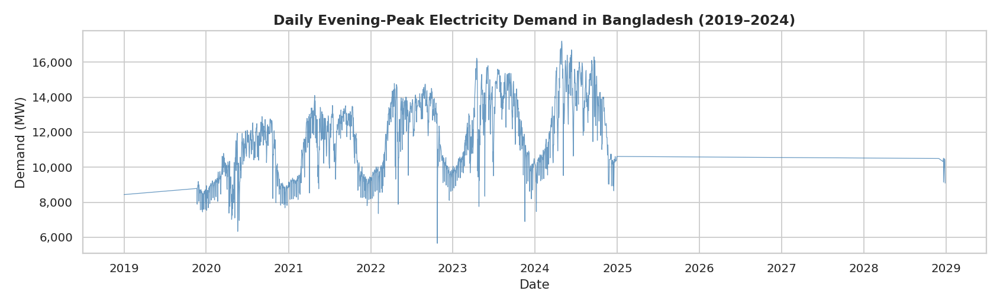

The analysis identifies an overall increase in electricity demand over the study period, with noticeable seasonal fluctuations.

### 5.2 Yearly Electricity Demand

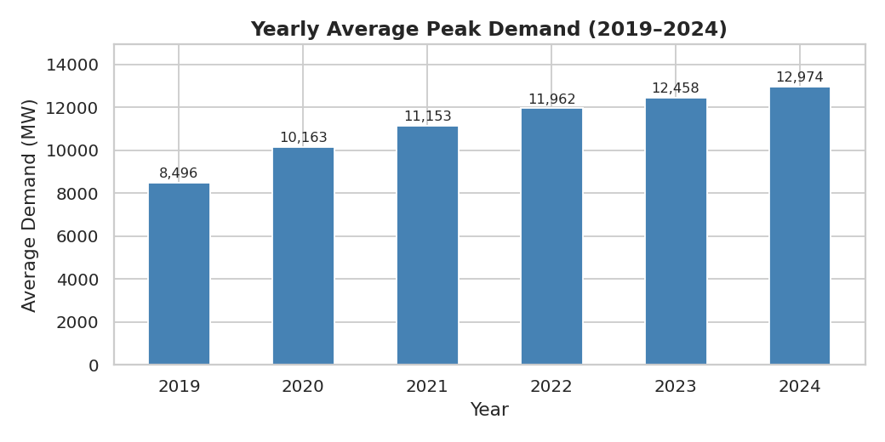

Average evening-peak demand increased from approximately **8,496 MW in the partial year 2019** to **12,950 MW in 2024**.

This represents an increase of approximately 52%, although the partial coverage of 2019 should be considered when interpreting the comparison.

### 5.3 Monthly and Seasonal Variations

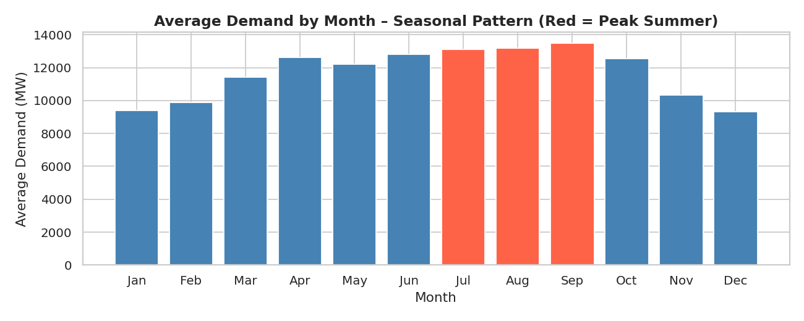

The analysis reveals seasonal variation in electricity demand.

Demand is generally lower during cooler months and higher during warmer periods.

The reported monthly averages indicate approximately:

- December: 9,303 MW
- September: 13,468 MW

### 5.4 Temperature and Electricity Demand

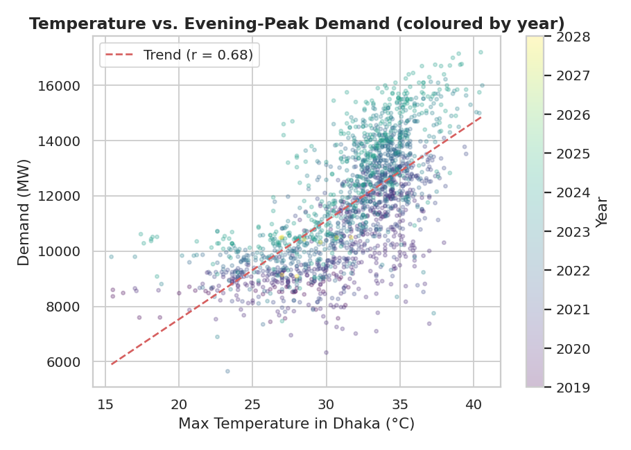

The relationship between maximum daily temperature in Dhaka and evening-peak electricity demand is investigated.

The reported Pearson correlation coefficient is approximately **0.68**, indicating a moderately strong positive relationship.

Higher temperatures are generally associated with increased electricity demand, particularly due to cooling requirements.

### 5.5 Load Shedding Analysis

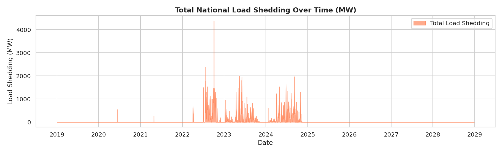

The analysis examines changes in load shedding over the study period.

A significant increase is observed from 2022 onward, corresponding to periods of fuel supply constraints and electricity generation difficulties.

### 5.6 Correlation Analysis

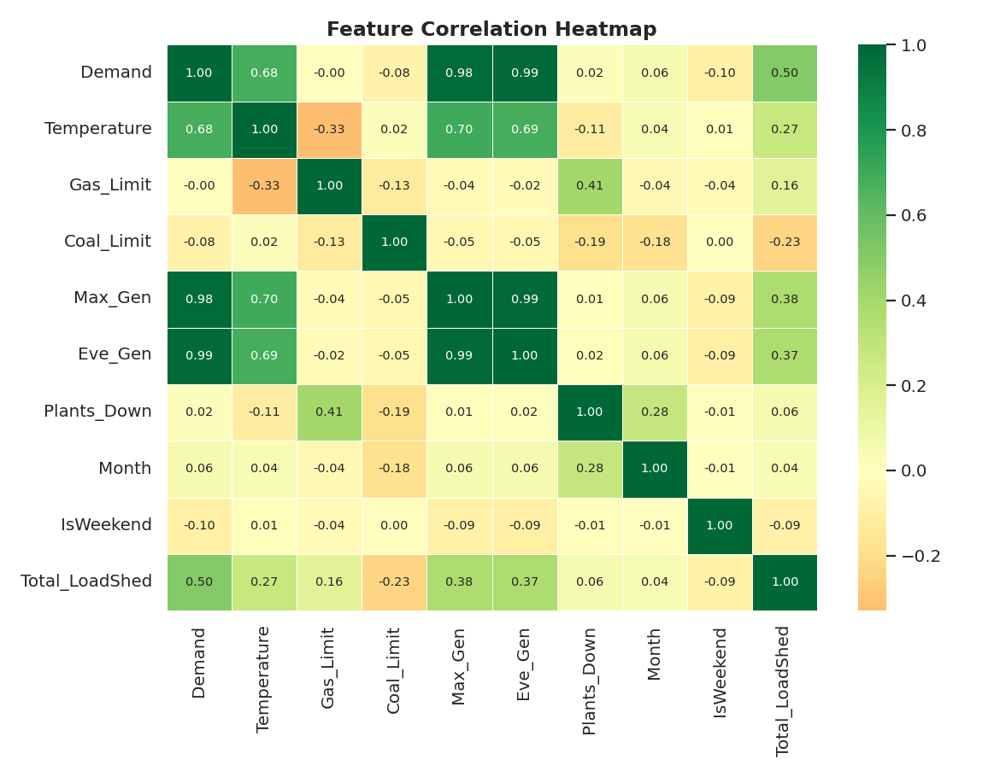

A correlation heatmap is used to examine relationships among numerical electricity system variables.

This analysis helps identify strongly associated features and provides context for machine learning model development.

### 5.7 Yearly Demand Distribution

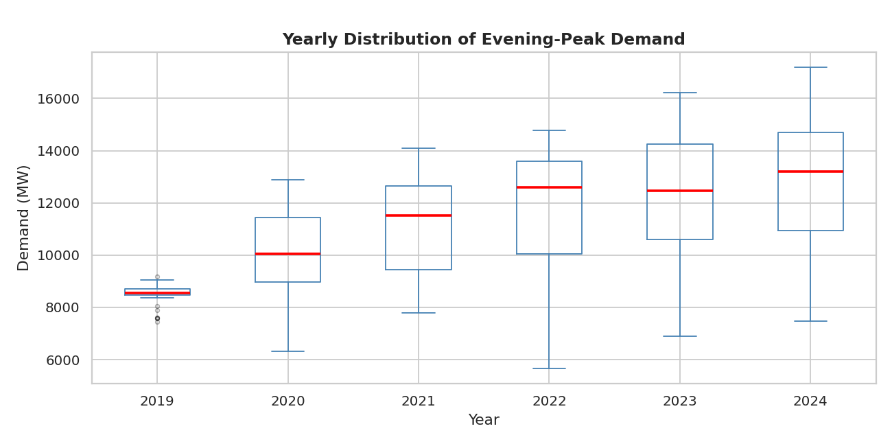

Yearly boxplots illustrate the distribution, variability, and spread of electricity demand across different years.

### 5.8 Fuel Constraints and Electricity Demand

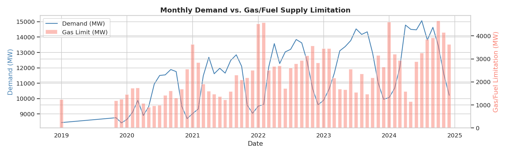

Fuel supply limitations are examined in relation to electricity demand.

The analysis highlights increasing gas and liquid fuel limitations over the study period.

### 5.9 Regional Electricity Demand

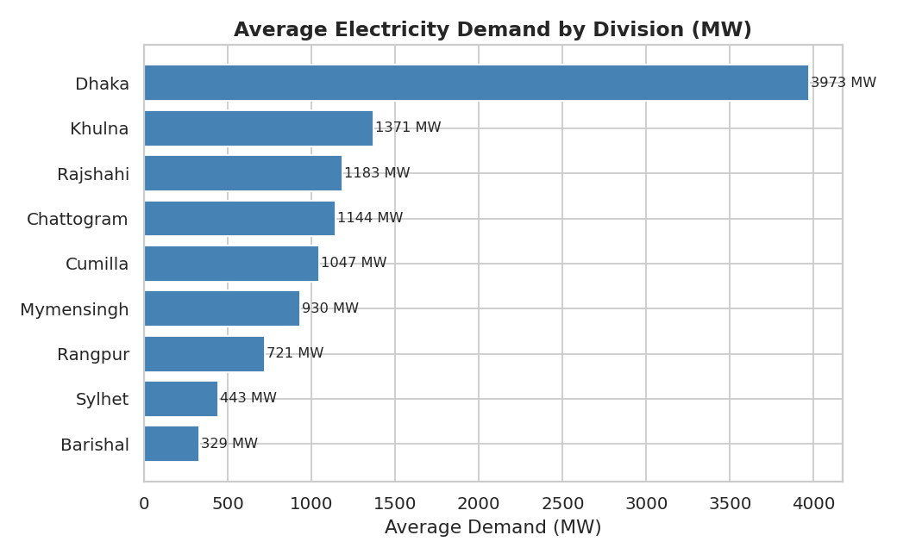

The regional analysis compares electricity demand across Bangladesh's administrative divisions.

Dhaka accounts for the largest share of regional demand, followed by other major consumption regions.

### 5.10 Day-of-Week Demand Patterns

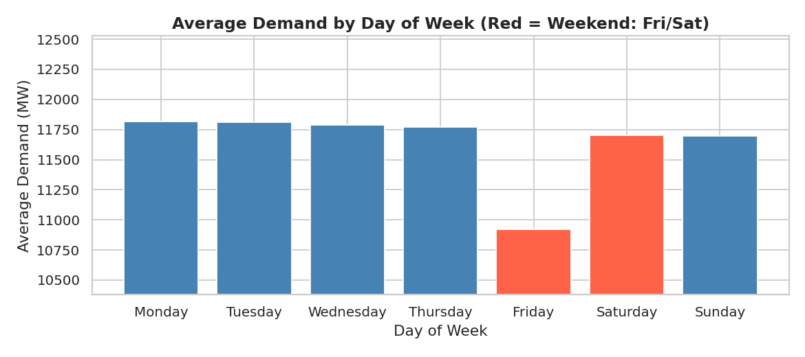

Electricity demand is compared across different days of the week.

The analysis identifies differences between regular working days and the Friday–Saturday weekend.

### 5.11 Generation–Demand Gap

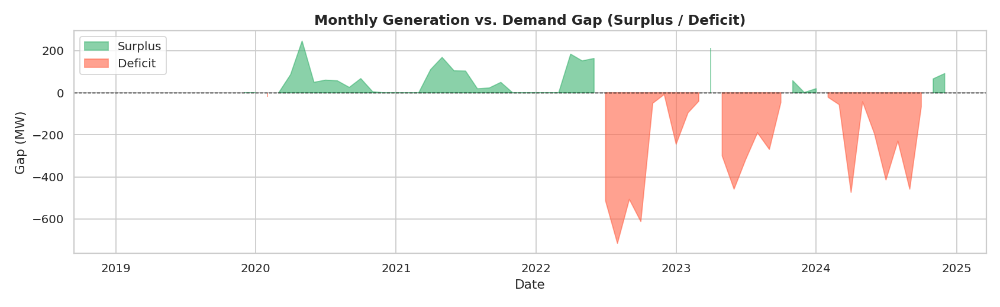

The difference between recorded generation and electricity demand is analyzed to investigate periods of generation surplus and deficit.

The results provide additional insight into operational constraints affecting Bangladesh's electricity system.

### 5.12 Smoothed Electricity Demand Trend

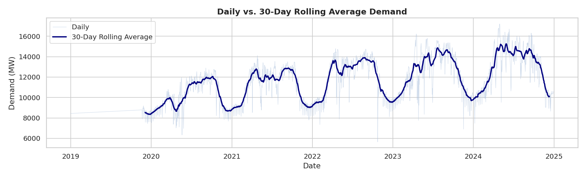

A 30-day centered rolling average is applied to the demand series to highlight underlying trends while reducing short-term fluctuations.

This visualization helps identify long-term growth and recurring seasonal patterns.

## 6. Machine Learning Model Development

The project formulates evening-peak electricity demand estimation as a supervised regression problem.

Three machine learning algorithms are implemented and compared.

### 6.1 Prediction Target

The target variable is:

**Maximum demand at evening peak — generation end (MW)**

The objective is to estimate the recorded evening-peak demand using selected historical electricity system features.

### 6.2 Input Features

Ten input features are used:

| Category | Feature |
|---|---|
| Environmental | Maximum temperature in Dhaka |
| Fuel constraints | Gas/liquid fuel limitation |
| Fuel constraints | Coal supply limitation |
| Operational constraints | Low water level at Kaptai |
| Operational constraints | Number of offline power plants |
| Generation | Maximum daily generation |
| Generation | Morning generation forecast |
| Temporal | Month |
| Temporal | Day of week |
| Temporal | Weekend indicator |

### 6.3 Linear Regression

Linear Regression is used as a baseline model.

It represents the predicted target as a linear combination of input features:

\[
\hat{y}=\beta_0+\sum_{i=1}^{n}\beta_i x_i
\]

where:

- \(\hat{y}\) is the predicted electricity demand
- \(x_i\) represents an input feature
- \(\beta_i\) represents the corresponding model coefficient
- \(\beta_0\) is the intercept

Feature standardization is applied for this model.

### 6.4 Random Forest Regression

Random Forest is an ensemble learning algorithm that combines predictions from multiple decision trees.

The implementation uses:

- 100 decision trees
- `random_state=42`

Random Forest can capture nonlinear relationships and interactions between input features.

### 6.5 Gradient Boosting Regression

Gradient Boosting is an ensemble learning algorithm that builds decision trees sequentially to reduce prediction errors.

The implementation uses:

- 100 boosting stages
- `random_state=42`

This model achieved the best reported RMSE and R² among the three evaluated algorithms.

### 6.6 Train-Test Split

The cleaned dataset is divided into:

- 80% training data
- 20% testing data

A fixed random seed of 42 is used for reproducibility.

The project also performs five-fold cross-validation on the selected Gradient Boosting model.

**Methodological note:** The evaluation uses a random train-test split rather than a chronological split. Therefore, the reported results represent performance on randomly held-out historical records and should not be interpreted as independently validated future forecasting accuracy.

## 7. Model Evaluation and Results

Three evaluation metrics are used to compare model performance.

### 7.1 Evaluation Metrics

**Mean Absolute Error (MAE)**

\[
MAE=\frac{1}{n}\sum_{i=1}^{n}|y_i-\hat{y}_i|
\]

MAE measures the average absolute difference between actual and predicted demand.

**Root Mean Squared Error (RMSE)**

\[
RMSE=\sqrt{\frac{1}{n}\sum_{i=1}^{n}(y_i-\hat{y}_i)^2}
\]

RMSE penalizes larger prediction errors more heavily.

**Coefficient of Determination (R²)**

\[
R^2=1-\frac{\sum_{i=1}^{n}(y_i-\hat{y}_i)^2}{\sum_{i=1}^{n}(y_i-\bar{y})^2}
\]

R² indicates how much variation in the target variable is explained by the model.

### 7.2 Model Performance Comparison

The reported test-set results are:

| Model | MAE (MW) | RMSE (MW) | R² Score |
|---|---:|---:|---:|
| Linear Regression | 219.2 | 455.4 | 0.9518 |
| Random Forest | **195.6** | 458.1 | 0.9512 |
| Gradient Boosting | 206.7 | **430.9** | **0.9569** |

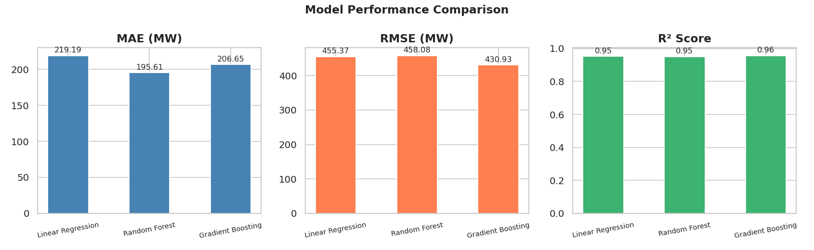

**Key observations:**

- Gradient Boosting achieved the lowest RMSE and highest R².
- Random Forest achieved the lowest MAE.
- All three models achieved reported R² scores above 0.95 on the random test split.

### 7.3 Actual vs. Predicted Demand

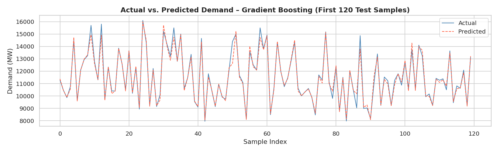

The predicted electricity demand values are compared against the actual observations to assess model agreement.

### 7.4 Prediction Scatter Plot

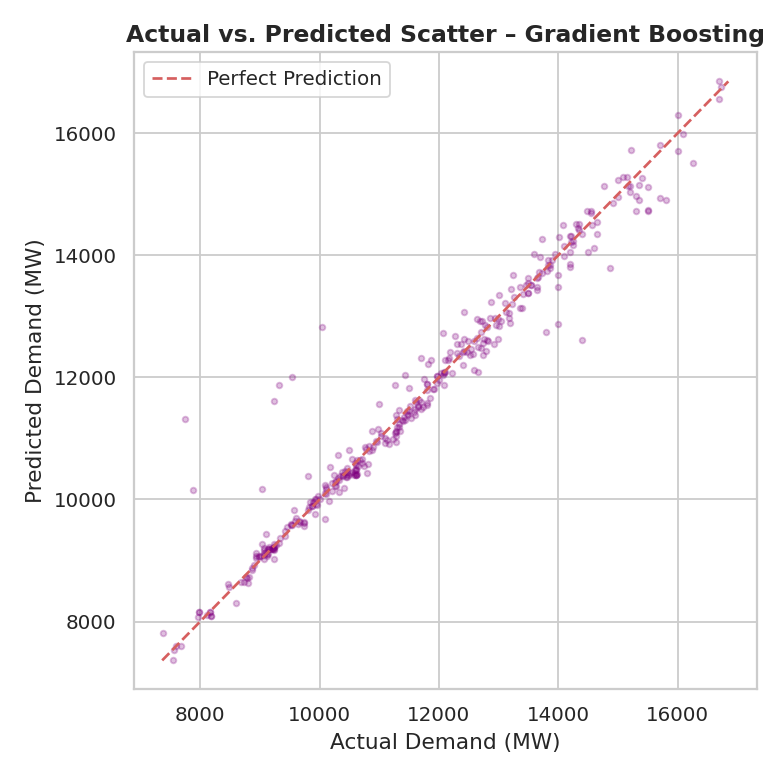

A scatter plot illustrates the relationship between actual and predicted demand values.

### 7.5 Residual Analysis

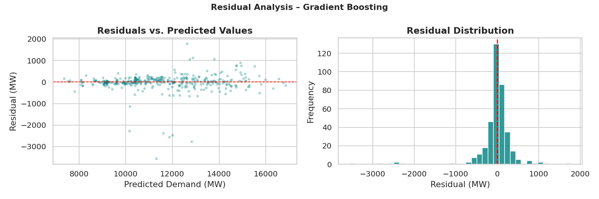

Residual analysis is performed to examine prediction errors and identify possible systematic deviations.

The report indicates that the residuals are approximately centered around zero, with larger errors occurring for some unusually high-demand observations.

### 7.6 Feature Importance

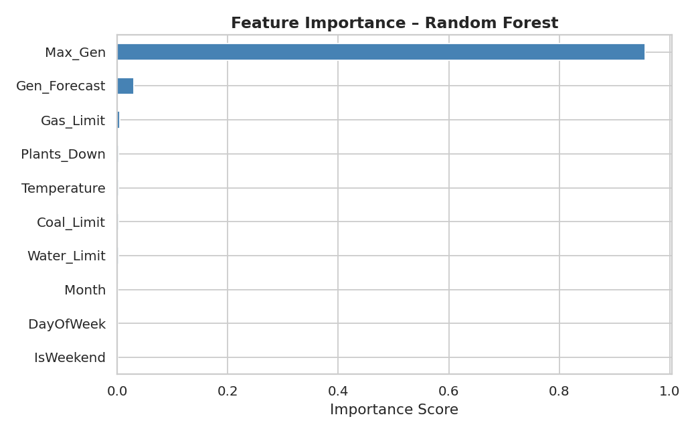

Random Forest feature importance is used to assess the relative contribution of the input variables.

The analysis identifies maximum daily generation as the dominant predictor, accounting for approximately 95.6% of the reported feature importance.

Morning generation forecast contributes approximately 3.0%, while the remaining variables collectively account for a smaller proportion.

This indicates a strong association between recorded generation and recorded demand in the dataset.

### 7.7 Cross-Validation

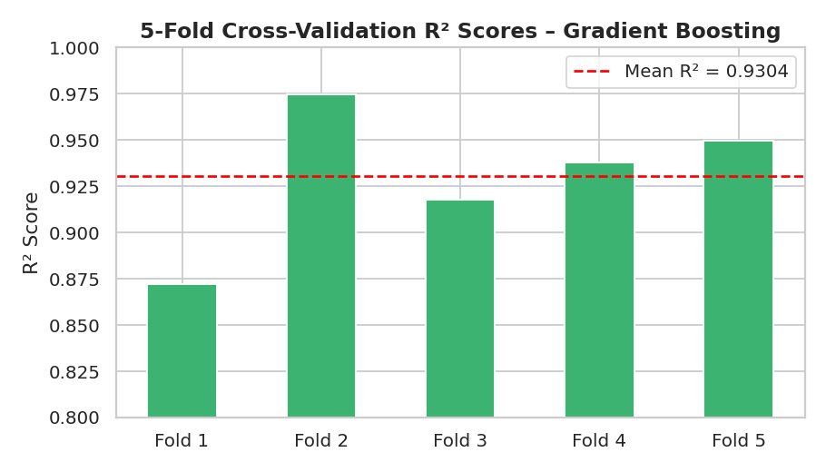

Five-fold cross-validation is performed on the Gradient Boosting model.

The reported R² scores are:

| Fold | R² Score |
|---|---:|
| 1 | 0.964 |
| 2 | 0.972 |
| 3 | 0.894 |
| 4 | 0.937 |
| 5 | 0.949 |
| **Mean** | **0.943** |

The reported standard deviation is approximately 0.028.

These results indicate variation in performance across different randomly partitioned subsets of the historical data.

## 8. Discussion and Key Findings

The analysis provides several observations about Bangladesh's electricity system.

**Long-term demand growth**

Recorded electricity demand increased substantially between 2019 and 2024, reflecting changes in electricity consumption and generation requirements.

**Seasonal electricity consumption**

Demand exhibits recurring seasonal patterns, with higher consumption during warmer periods.

**Temperature dependence**

A positive relationship exists between daily maximum temperature and electricity demand.

**Fuel supply constraints**

Fuel availability and generation limitations are important factors in understanding Bangladesh's electricity supply challenges, particularly from 2022 onward.

**Regional differences**

Electricity demand varies considerably across administrative divisions, with Dhaka representing the largest consumption region.

**Machine learning performance**

Gradient Boosting achieved the best reported RMSE and R² among the three evaluated models.

**Generation-demand relationship**

Maximum generation strongly influences model predictions. This also highlights the distinction between recorded or served electricity demand and the total underlying demand that may exist during load shedding.

## 9. Technologies and Tools

| Category | Technologies |
|---|---|
| Programming | Python |
| Development environment | Google Colab, Jupyter Notebook |
| Data manipulation | pandas, NumPy |
| Visualization | Matplotlib, Seaborn |
| Machine learning | scikit-learn |
| Data source format | Microsoft Excel (`.xlsx`) |
| Regression algorithms | Linear Regression, Random Forest, Gradient Boosting |
| Evaluation | MAE, RMSE, R², cross-validation |

## 10. Installation and Execution

The project was developed and executed using **Google Colab**.

The notebook can be run without installing Python or additional software locally.

### 10.1 Requirements

- Google account
- Google Colab
- Original Version 1 dataset
- Project Jupyter Notebook

### 10.2 Download the Repository

Clone the repository:

```bash
git clone https://github.com/mashrursaademad/bangladesh-electricity-consumption-analysis.git
```

Alternatively, download the repository as a ZIP file from GitHub.

### 10.3 Open the Notebook in Google Colab

1. Open https://colab.research.google.com/
2. Select **File → Upload notebook**.
3. Upload:

   `notebooks/electricity_consumption_analysis.ipynb`

4. Wait for the notebook to open.

### 10.4 Download the Dataset

Download **Version 1** from the original dataset repository:

https://doi.org/10.17632/x7r7wdb39k.1

Ensure the downloaded Excel file is named:

`version 1.xlsx`

The notebook expects this exact filename.

### 10.5 Upload the Dataset to Colab

1. Open the Files panel on the left side of Google Colab.
2. Select **Upload**.
3. Upload `version 1.xlsx`.
4. Confirm that the file is available in the Colab working directory.

The notebook loads the dataset using:

```python
df = pd.read_excel('version 1.xlsx')
```

No modification to the dataset-loading code is necessary when the file is uploaded to the expected working directory.

### 10.6 Execute the Notebook

Select:

**Runtime → Run all**

The notebook will execute the preprocessing, exploratory analysis, model training, evaluation, and visualization cells.

The generated figures can be downloaded from the Colab Files panel.

**Note:** Files uploaded to a Colab runtime are temporary and may need to be uploaded again when starting a new session.

## 11. Project Structure

```text
bangladesh-electricity-consumption-analysis/
│
├── README.md
├── requirements.txt
├── .gitignore
│
├── notebooks/
│   └── electricity_consumption_analysis.ipynb
│
├── documentation/
│   └── EEE4710_Project_Report.pdf
│
└── results/
    └── figures/
        ├── exploratory-analysis/
        │   ├── plot_01_demand_trend.png
        │   ├── plot_02_yearly_demand.png
        │   ├── plot_03_monthly_seasonality.png
        │   ├── plot_04_temp_demand.png
        │   ├── plot_05_load_shedding.png
        │   ├── plot_06_heatmap.png
        │   ├── plot_07_boxplot_yearly.png
        │   ├── plot_08_gas_vs_demand.png
        │   ├── plot_09_regional_demand.png
        │   ├── plot_10_weekday_demand.png
        │   ├── plot_11_gen_demand_gap.png
        │   └── plot_12_rolling_avg.png
        │
        └── model-evaluation/
            ├── plot_13_model_comparison.png
            ├── plot_14_actual_vs_predicted.png
            ├── plot_15_scatter.png
            ├── plot_16_residuals.png
            ├── plot_17_feature_importance.png
            └── plot_18_cross_validation.png
```

The figures are organized manually after being generated and downloaded from Google Colab.

The original Excel dataset is not included in this repository and can be downloaded from the dataset provider.

## 12. Documentation

The complete academic project report is available here:

[EEE4710 — Bangladesh Electricity Consumption Analysis Project Report](documentation/EEE4710_Project_Report.pdf)

The report contains the project background, dataset description, preprocessing methodology, exploratory analysis, machine learning model development, performance evaluation, discussion, and limitations.

## 13. Limitations and Future Improvements

### 13.1 Raw Dataset Quality

The project uses Version 1 of the dataset, which contains missing entries and inconsistencies from the original extraction process.

Forward-fill and backward-fill imputation may not accurately represent all missing observations.

### 13.2 Random Train-Test Split

The models are evaluated using a random train-test split rather than a chronological split.

This approach evaluates generalization across historical records but does not directly establish performance on future unseen time periods.

A chronological evaluation would provide a more appropriate basis for operational forecasting claims.

### 13.3 Potential Data Leakage

Preprocessing is performed before splitting the dataset into training and testing subsets.

This creates a risk that information from the test period influences preprocessing decisions.

A future implementation could perform preprocessing within training-only pipelines and evaluate the models using time-aware validation.

### 13.4 Generation-Based Predictors

Maximum daily generation is the dominant predictor in the models.

Because recorded demand and actual generation are closely related in a supply-constrained electricity system, this feature may inflate apparent predictive performance and may not be available at the required time for a genuine ahead-of-time forecast.

### 13.5 Future Improvements

Possible extensions include:

- Chronological train-test splitting
- Time-series cross-validation
- Improved missing-value imputation
- Comparison with later dataset versions
- Additional weather and holiday-related features
- Lagged demand features
- Time-series forecasting models
- Evaluation of prediction performance without contemporaneous maximum generation

These extensions could improve the project's usefulness for future electricity demand forecasting.

## 14. Contributors and Author

### 14.1 Contributors

Developed as a group academic project for:

**Course:** EEE 4710 - Artificial Intelligence and Machine Learning Lab  
**Institution:** Islamic University of Technology (IUT)  
**Group:** Bangi

**Team Members:**

- Shafath Uddin Khoundaker
- Mashrur Saad Emad
- Anisha Mustafa Maisha
- Nusaiba Nowar

### 14.2 Repository Maintainer

**Mashrur Saad Emad**  
Electrical and Electronic Engineering Graduate  
Islamic University of Technology (IUT)

[GitHub Profile](https://github.com/mashrursaademad)  
[LinkedIn Profile](https://www.linkedin.com/in/mashrur-saad-emad-787995436/)

---

*This repository documents an undergraduate machine learning and power systems data analysis project developed for academic and educational purposes.*
